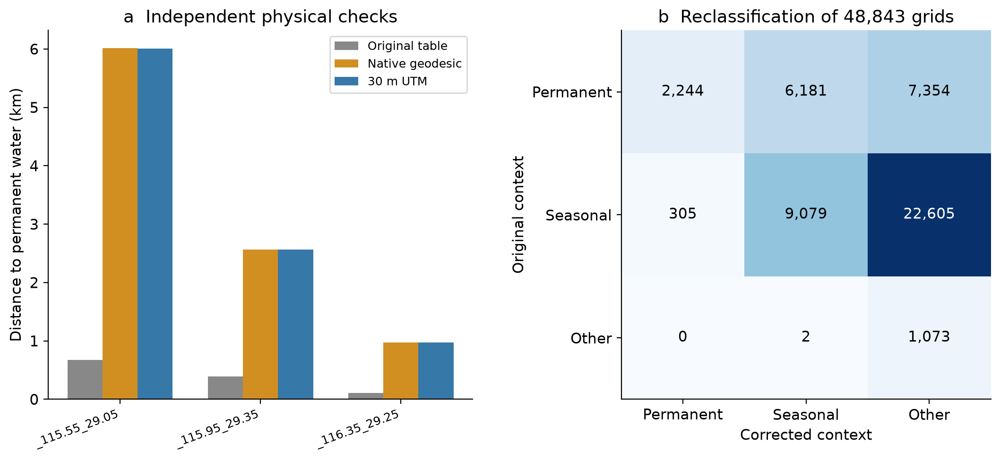

# Complete quantitative figure inventory

Scope matters: corrected results, additional diagnostics and legacy algorithm audits are separate. A legacy distance curve is not physical ecological evidence.

## Current main corrected evidence

### Fig1_workflow

[PDF](../revised_figures/figures/Fig1_workflow.pdf)

### Fig2_JRC_attributes

[PDF](../revised_figures/figures/Fig2_JRC_attributes.pdf)

### Fig3_corrected_contexts

[PDF](../revised_figures/figures/Fig3_corrected_contexts.pdf)

### Fig4_exposure_risks

[PDF](../revised_figures/figures/Fig4_exposure_risks.pdf)

### Fig5_context_fragility

[PDF](../revised_figures/figures/Fig5_context_fragility.pdf)

### Fig6_corrected_contrasts

[PDF](../revised_figures/figures/Fig6_corrected_contrasts.pdf)

### Fig7_landscape_contrasts

[PDF](../revised_figures/figures/Fig7_landscape_contrasts.pdf)

### Fig8_spatial_uncertainty

[PDF](../revised_figures/figures/Fig8_spatial_uncertainty.pdf)

### SFig18_distance_validation

[PDF](../revised_figures/figures/SFig18_distance_validation.pdf)

## Additional corrected sensitivity/diagnostics

### SFig12_noncrop_sensitivity

[PDF](../reviewer_evidence/figures/SFig12_noncrop_sensitivity.pdf)

### SFig13_corrected_balance

[PDF](../reviewer_evidence/figures/SFig13_corrected_balance.pdf)

### SFig14_corrected_HDSI

[PDF](../reviewer_evidence/figures/SFig14_corrected_HDSI.pdf)

### SFig15_corrected_thresholds

[PDF](../reviewer_evidence/figures/SFig15_corrected_thresholds.pdf)

### SFig16_corrected_year_omissions

[PDF](../reviewer_evidence/figures/SFig16_corrected_year_omissions.pdf)

### SFig17_sample_flow

[PDF](../reviewer_evidence/figures/SFig17_sample_flow.pdf)

## Historical/reproduction audit (SFig9–11 corrected)

### Fig1_verified_workflow

[PDF](../figures/Fig1_verified_workflow.pdf)

### Fig2_JRC_metrics_discrete_transition

[PDF](../figures/Fig2_JRC_metrics_discrete_transition.pdf)

### Fig3_context_and_combined_events

[PDF](../figures/Fig3_context_and_combined_events.pdf)

### Fig4_HDSI_and_event_risks

[PDF](../figures/Fig4_HDSI_and_event_risks.pdf)

### Fig5_numeric_distance_bands

[PDF](../figures/Fig5_numeric_distance_bands.pdf)

### Fig6_context_risk_and_fragility

[PDF](../figures/Fig6_context_risk_and_fragility.pdf)

### Fig7_exploratory_diagnostics

[PDF](../figures/Fig7_exploratory_diagnostics.pdf)

### Fig8_all_regions_with_support

[PDF](../figures/Fig8_all_regions_with_support.pdf)

### SFig10_corrected_1km_spatial_blocks

[PDF](../figures/SFig10_corrected_1km_spatial_blocks.pdf)

### SFig11_corrected_1km_context_map

[PDF](../figures/SFig11_corrected_1km_context_map.pdf)

### SFig1_same_sample_adjustment

[PDF](../figures/SFig1_same_sample_adjustment.pdf)

### SFig2_spatial_block_uncertainty

[PDF](../figures/SFig2_spatial_block_uncertainty.pdf)

### SFig3_HDSI_variants

[PDF](../figures/SFig3_HDSI_variants.pdf)

### SFig4_event_thresholds

[PDF](../figures/SFig4_event_thresholds.pdf)

### SFig5_leave_analysis_year_out

[PDF](../figures/SFig5_leave_analysis_year_out.pdf)

### SFig6_centroid_distance_spline

[PDF](../figures/SFig6_centroid_distance_spline.pdf)

### SFig7_within_cell_pilot

[PDF](../figures/SFig7_within_cell_pilot.pdf)

### SFig8_harmonized_and_landscape

[PDF](../figures/SFig8_harmonized_and_landscape.pdf)

### SFig9_corrected_1km_permanence

[PDF](../figures/SFig9_corrected_1km_permanence.pdf)

