# Figure gallery

Main and supplementary figures follow the experimental sequence. Numerical inputs are listed in [figure_source_map.csv](../final_results/figure_source_map.csv).

## Fig1

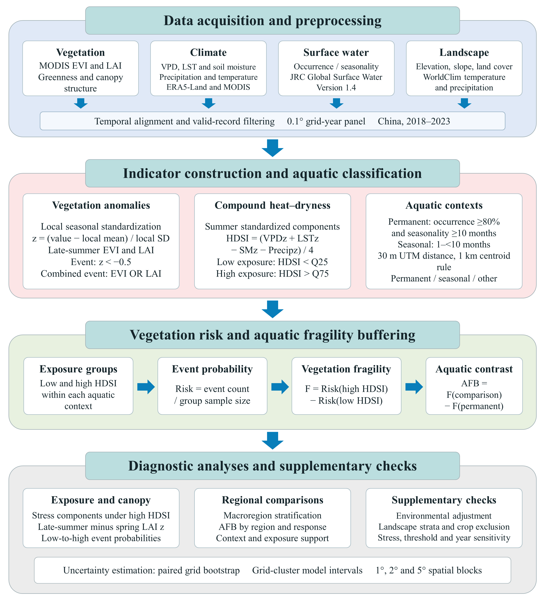

[PDF](../final_results/figures/Fig1.pdf)

## Fig2

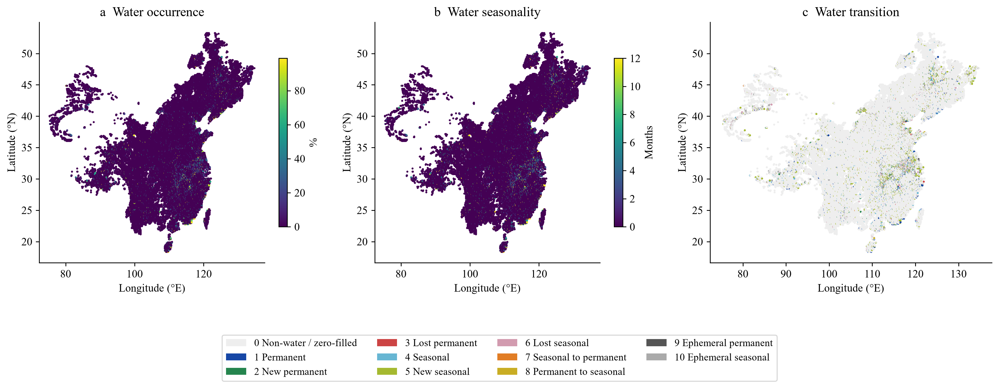

[PDF](../final_results/figures/Fig2.pdf)

## Fig3

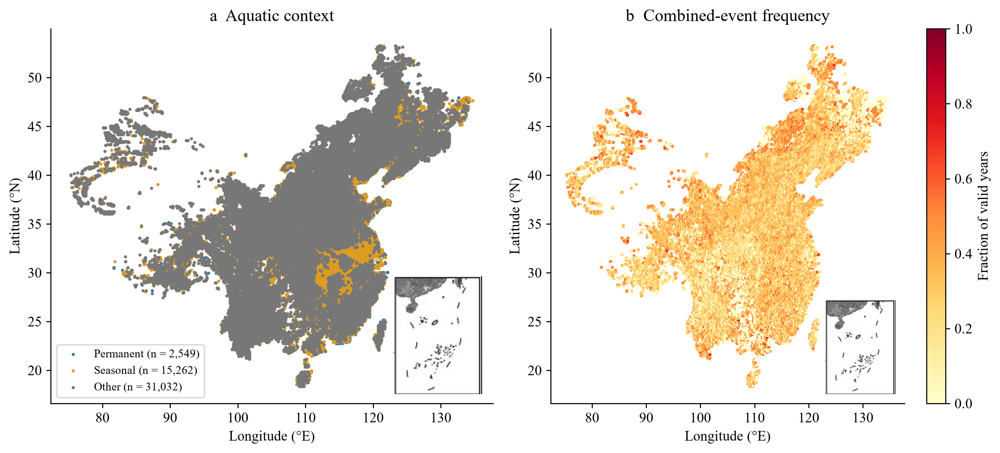

[PDF](../final_results/figures/Fig3.pdf)

## Fig4

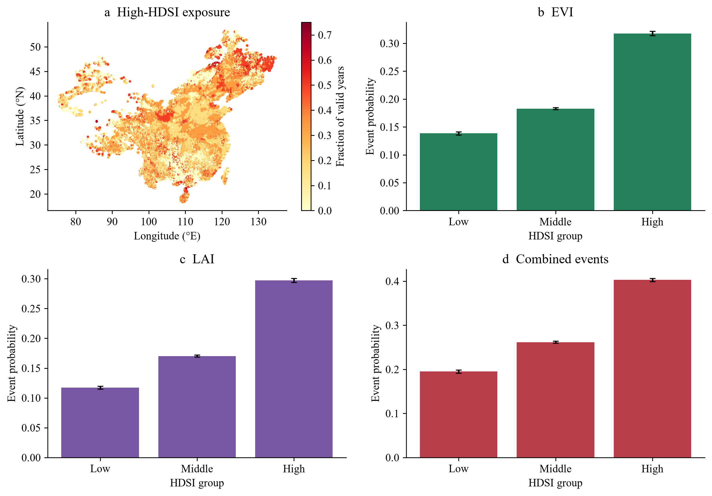

[PDF](../final_results/figures/Fig4.pdf)

## Fig5

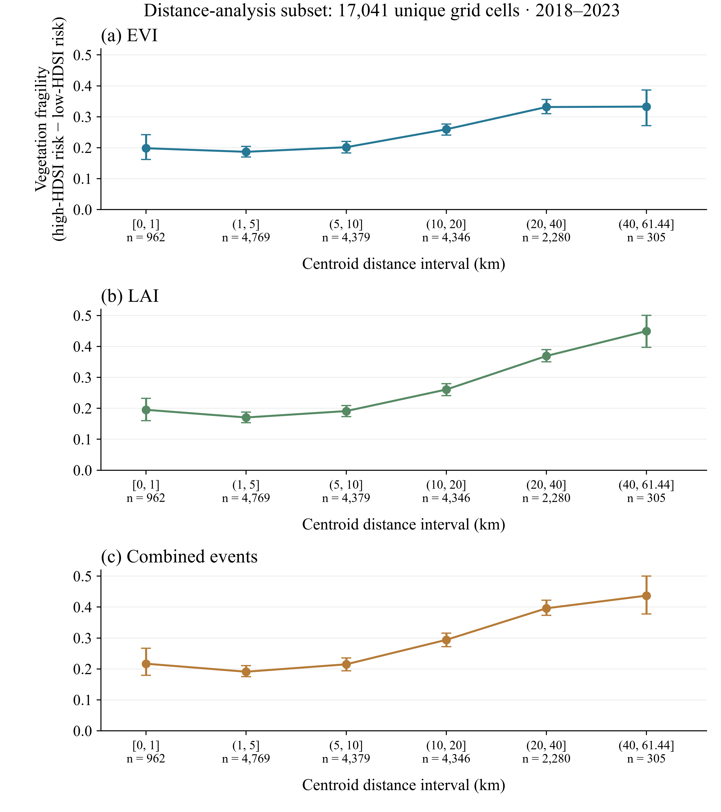

[PDF](../final_results/figures/Fig5.pdf)

## Fig6

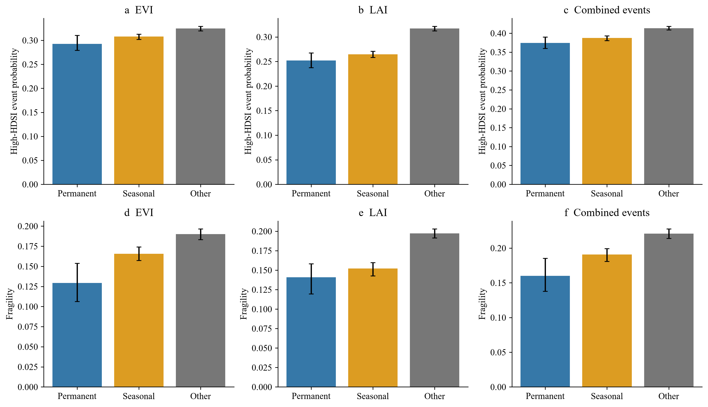

[PDF](../final_results/figures/Fig6.pdf)

## Fig7

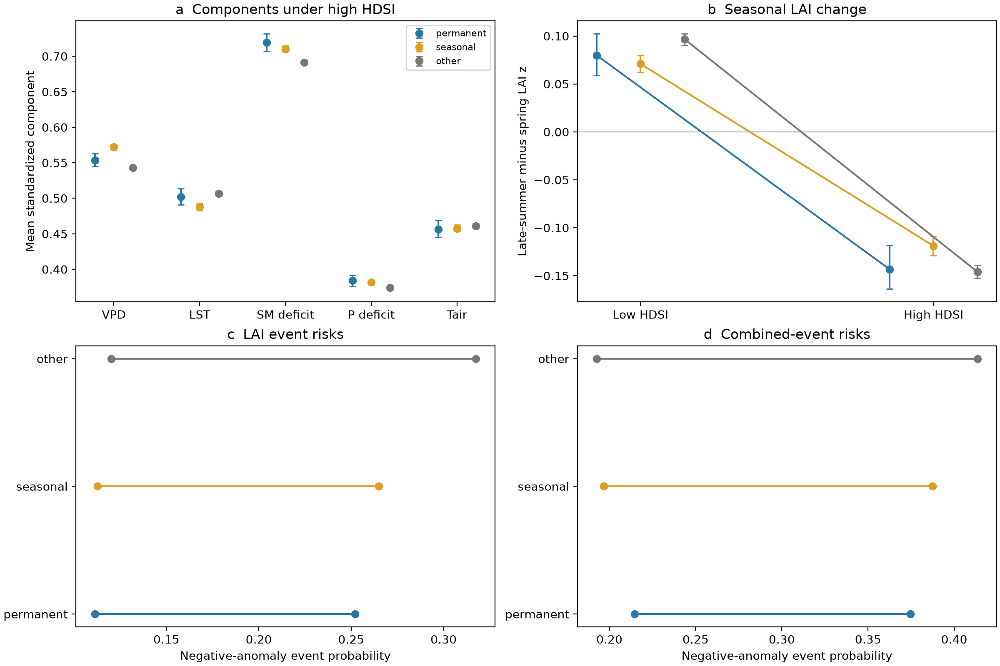

[PDF](../final_results/figures/Fig7.pdf)

## Fig8

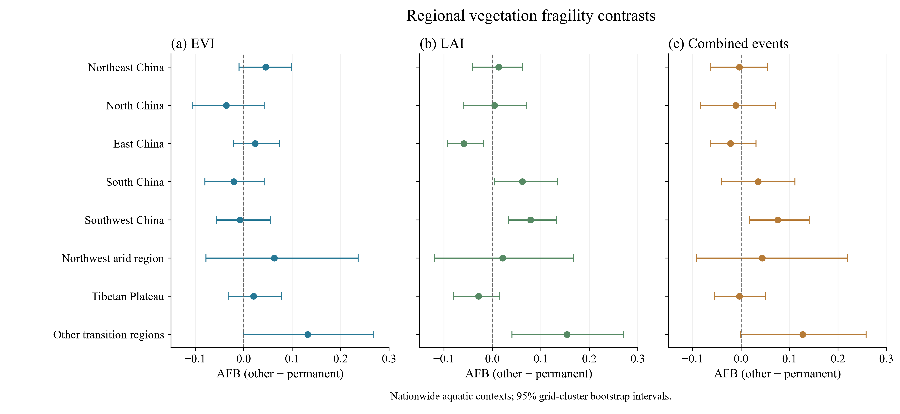

[PDF](../final_results/figures/Fig8.pdf)

## Fig_S1

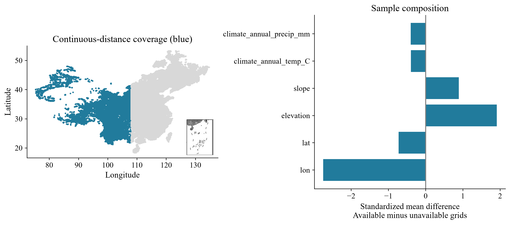

[PDF](../final_results/figures/Fig_S1.pdf)

## Fig_S2

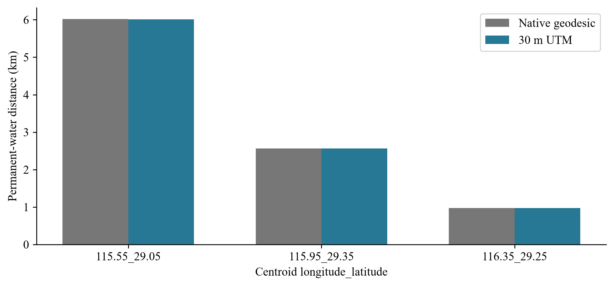

[PDF](../final_results/figures/Fig_S2.pdf)

## Fig_S3

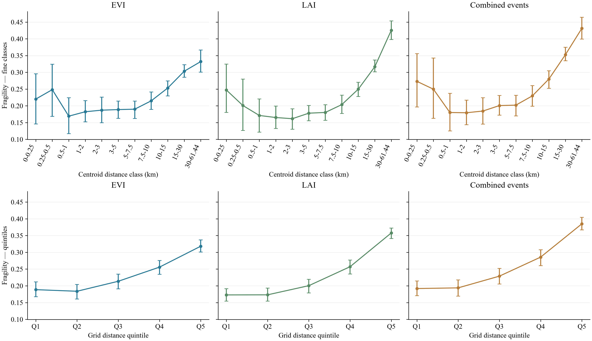

[PDF](../final_results/figures/Fig_S3.pdf)

## Fig_S4

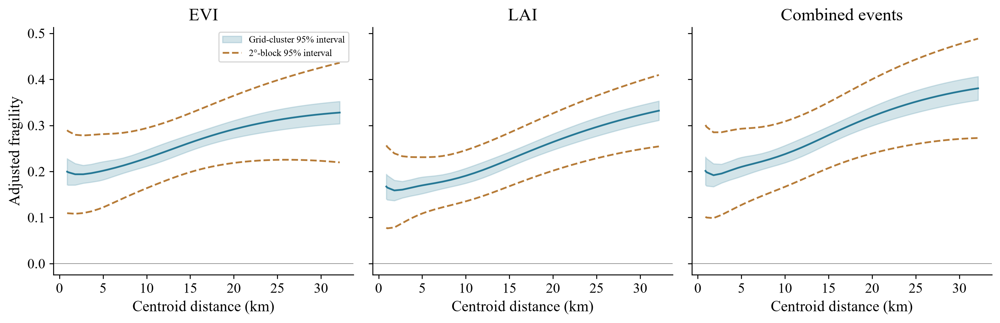

[PDF](../final_results/figures/Fig_S4.pdf)

## Fig_S5

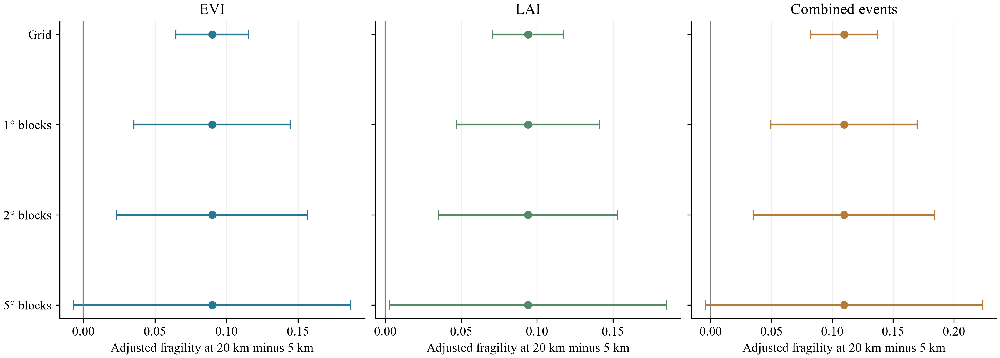

[PDF](../final_results/figures/Fig_S5.pdf)

## Fig_S6_adjusted_contrasts

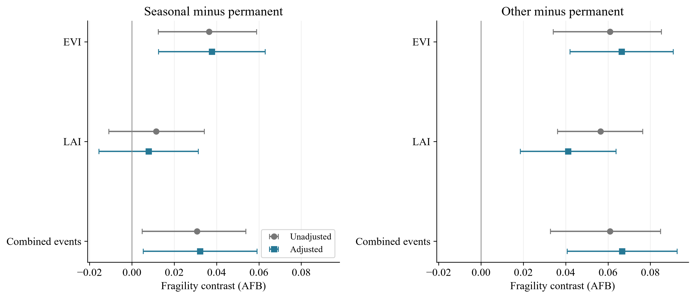

[PDF](../final_results/figures/Fig_S6_adjusted_contrasts.pdf)

## Fig_S7_common_landscapes

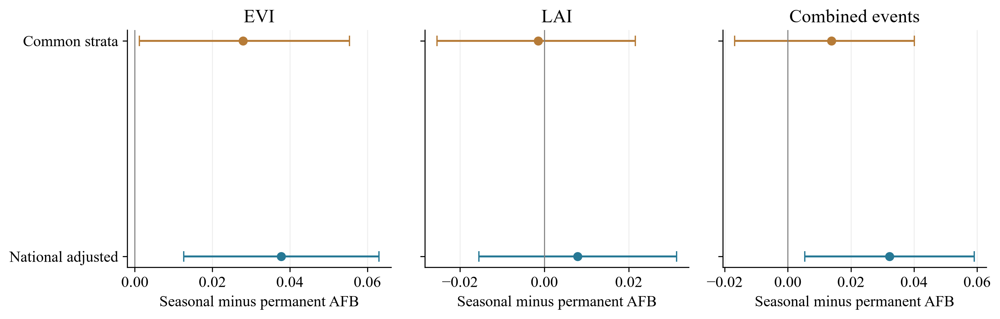

[PDF](../final_results/figures/Fig_S7_common_landscapes.pdf)

## Fig_S8_covariate_balance

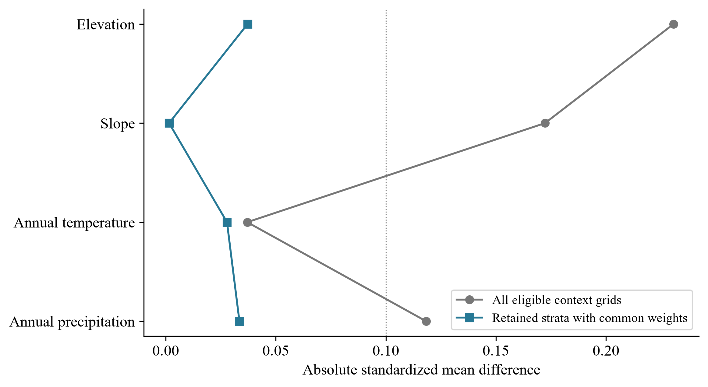

[PDF](../final_results/figures/Fig_S8_covariate_balance.pdf)

## Fig_S9_noncropland

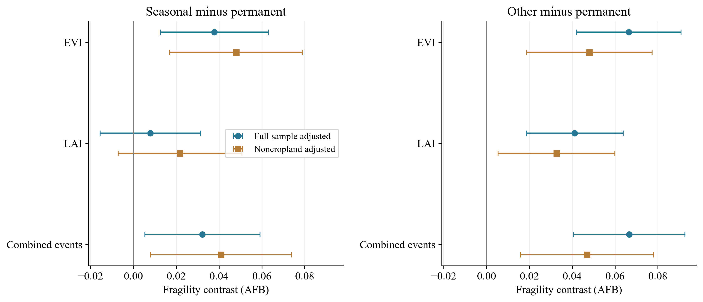

[PDF](../final_results/figures/Fig_S9_noncropland.pdf)

## Fig_S10

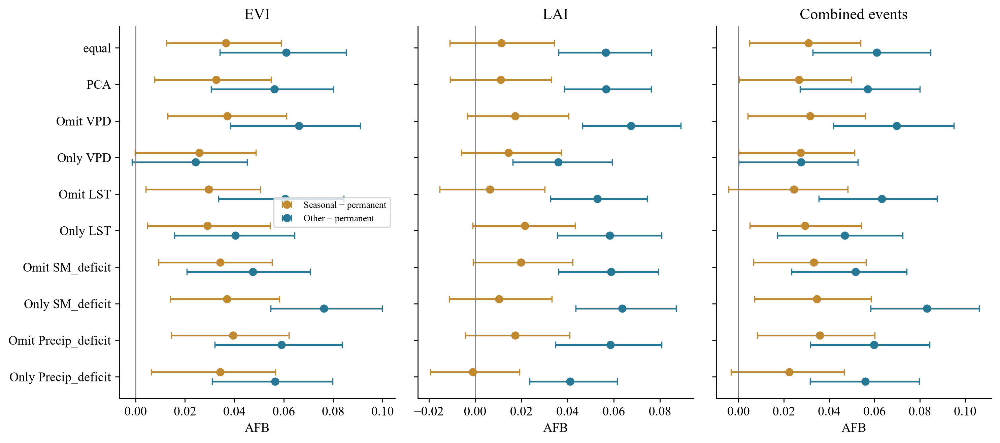

[PDF](../final_results/figures/Fig_S10.pdf)

## Fig_S11

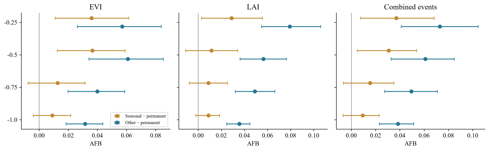

[PDF](../final_results/figures/Fig_S11.pdf)

## Fig_S12

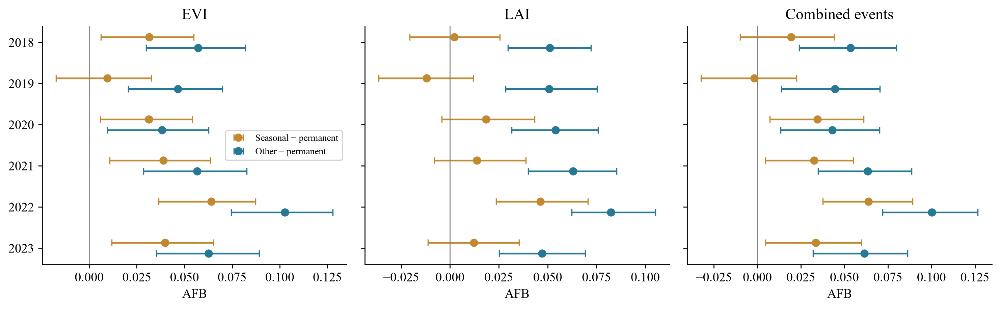

[PDF](../final_results/figures/Fig_S12.pdf)

## Fig_S13

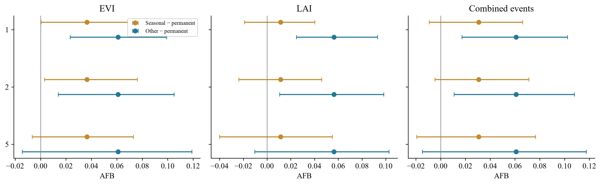

[PDF](../final_results/figures/Fig_S13.pdf)

