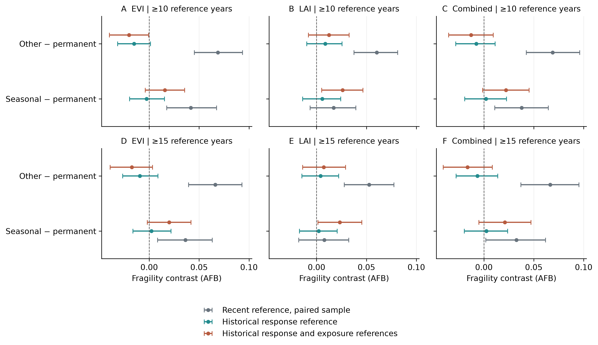

# Independent historical reference

This experiment compares vegetation fragility during 2018–2023 using a recent seasonal reference and a non-overlapping 2001–2017 reference. It uses 102 archived annual 16-day files across six China-intersecting export regions. The primary recent-reference analysis is retained separately.

## Calculation

1. Select cells from the national analysis panel and read historical annual values for EVI, LAI, VPD, daytime LST, root-zone soil-moisture proxy and precipitation.
2. Apply the documented numeric range rules. Estimate cell-by-position historical means, sample standard deviations and valid-year counts. Require at least 10 valid historical years; repeat with 15.
3. Standardize target-period values, clip z scores to −5 to 5, and average valid positions over summer (DOY 152–243) for exposure and late summer (DOY 213–273) for responses.
4. On identical retained rows, compare A: recent reference; B: historical response with original exposure; C: historical response and exposure. EVI/LAI event thresholds remain z < −0.5, combined events use OR, and aquatic classes remain fixed.
5. Calculate context risks, high-minus-low fragility and comparison-minus-permanent AFB. Use 2,000 whole-cell bootstrap draws, seed 20261020, and percentile 95% intervals. Fix exposure quartiles within draws.

## Numerical interpretation

The 10-year rule retains 218,065 records from 42,829 cells; the 15-year rule retains 189,442 from 36,315. At the 10-year minimum, combined-event prevalence falls from 28.25% to 15.28% under the historical reference. With exposure held fixed, all six historical-response AFB intervals include zero. The other-minus-permanent combined-event contrast changes from 0.0690 [0.0426, 0.0960] to −0.0077 [−0.0282, 0.0113]. Re-standardizing exposure yields mixed contrast directions. The historical reference therefore does not establish a general positive permanence pattern.

The two references define different anomalies. Recent-reference estimates describe within-period departures, and historical-reference estimates describe departures from earlier conditions. Their disagreement limits baseline-independent ecological interpretation. Whole-cell intervals do not resolve neighbouring-cell dependence. Historical annual screening, upstream QA and land-only aggregation remain relevant limitations.

## Reproduction and evidence

Set `AQUATIC_PANEL` to the seasonal input, `RAW_CORE_PANEL` to the patched 16-day target-period panel, and `HISTORICAL_ARCHIVE` to the `dynamic_step16_by_year_region` archive directory. From the repository root run:

```text
python experiments/E07_historical_reference/historical_reference.py
python experiments/E07_historical_reference/plot_historical_reference.py
```

Historical files follow `year=YYYY/region_id=REGION/dynamic_step16_yYYYY_REGION.parquet`. The input inventory records all 102 paths relative to that archive. The six region caches are reused on subsequent runs; use a fresh `HISTORICAL_OUTPUT` directory when changing historical inputs or cleaning rules. The default output is this experiment directory. Regenerate the figure there from the published contrast CSV without private inputs by running only the plotting script.

`method.json` specifies processing rules; `sample_support.csv` and `retention_by_context.csv` document selection; `event_agreement.csv` records classification changes; `exposure_thresholds.csv` records exact cutpoints; `context_risks.csv` reports component risks and fragility; `independent_reference_AFB.csv` gives all contrasts and intervals. `reference_year_counts.csv` describes historical coverage. The direct-reference check compares stored sufficient statistics with direct calculations for 69 grid-position combinations. The archive overlap check compares common valid 2018 R_6_2 values with the current target panel at float32 precision; it does not verify upstream product settings. Large input panels and cached reference arrays are not distributed.


